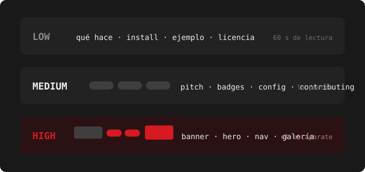

<div align="center">
  

  <p><strong>OpenCode skills that build READMEs that fucking slap.</strong><br>
  Three intensity levels, a router that knows what each project actually
  deserves, and zero maximalist templates spray-glued onto everything.</p>

  <p>
    <a href="LICENSE"></a>
    
    
    
  </p>

  
</div>

<p align="center">
  <a href="#why">Why</a> &#183; <a href="#the-four-skills">Skills</a> &#183; <a href="#three-philosophies-one-rule">Philosophies</a> &#183; <a href="#install">Install</a> &#183; <a href="#usage">Usage</a> &#183; <a href="#evals">Evals</a> &#183; <a href="#sources">Sources</a>
</p>

## Why

Because no: not every project needs a hero GIF and a row of fifteen badges.
A JSON parser with a banner looks like a content creator, and a terminal
theme without a demo GIF is basically a crime. The point isn't decorating
everything — it's reading each repo and giving it the intensity it deserves.

## The four skills

| ID | Loads when | What you get |
|---|---|---|
| `readme-pro` | Any README task, by default | Assesses the project, picks the level, routes to the matching recipe |
| `readme-pro-low` | Something simple/clean/sober; libraries, CLIs, internal tools | Documentation-first README: no badges, no images, no marketing |
| `readme-pro-medium` | A professional/standard README; apps and tools with an audience | The front door: pitch, informative badges, screenshot if there's UI, install, usage, config |
| `readme-pro-high` | When the look IS the product: UIs, TUIs, themes, dotfiles — or *"make the front page slap"* | The showcase: banner, badge row, hero, nav, gallery, community extras |

## Three philosophies, one rule

- **LOW (Yegor school)** — a README is read, not looked at. Every line
  informs or it's out.
- **MEDIUM (makeareadme / thoughtbot)** — the front door. What & why in one
  screen, working install in two.
- **HIGH (doomemacs / sniffnet)** — the README is part of the product
  experience. Identity first: the palette comes from the project itself, not
  from a generic blue shield.

The rule all three levels share: **fabricate nothing**. No badge for CI that
doesn't exist, no license badge without a LICENSE file, no screenshots of
features that don't run — and no HTML mock sneaked in as a screenshot. A
README that lies gets caught on the first clone.

## The tone

And yes, this README swears while the skills write sober ones. Not hypocrisy
— that's literally the skill's principle: the project sets the tone, not the
template.

**Zero dependencies:** works on any OS with nothing preinstalled — writing,
hand-authored SVGs, and web services. ImageMagick and vhs are optional
upgrades: the skill detects them and only uses them if they're already
there.

## Install

In a project — copy the skills you want:

```sh
cp -r readme-pro/.opencode/skills/readme-pro* your-repo/.opencode/skills/
```

Globally: same thing into `~/.config/opencode/skills/`. Or point your
`opencode.jsonc` at this repo:

```jsonc
{
  "$schema": "https://opencode.ai/config.json",
  "skills": ["~/Work/readme-pro/.opencode/skills"]
}
```

## Usage

- *"write a README for this project"* → `readme-pro` assesses and routes.
- *"keep it minimal, no badges"* → `readme-pro-low` directly.
- *"I want the front page to slap"* → `readme-pro-high`.

The router states the chosen level and the reason in one line, and the
recipe runs its checklist before the README is called done.

## Evals

Tests with real fixtures in [`evals/`](evals/), skill-creator methodology:
same prompts with and without the skill, programmatic grading plus human
review, two iterations.

| | with skill | baseline (mean, 4 runs) |
|---|---|---|
| assertions | **60/60** | 73% |

The case that says it all: one baseline, same prompt, rendered HTML mocks
and presented them as real screenshots. With the skill, the agent generated
real captures, found a bug, deleted the half-made assets and flagged it —
and on a locked-down machine (nothing installable) it still shipped the full
showcase with hand-written SVGs.

What `readme-pro-high` produces, live:
[`examples/graphite-theme/`](examples/graphite-theme/) — a complete showcase
README generated during the eval, banner, palette and community extras
included.

## Sources

The whole skill is a distillation of a curated study list:
[Make a README](https://www.makeareadme.com/),
[The Art of README](https://github.com/hacktivistto/The-Art-of-README),
[thoughtbot's guide](https://thoughtbot.com/blog/how-to-write-a-great-readme),
[README-Driven Development](https://tom.preston-werner.com/2010/08/23/readme-driven-development.html),
[Elegant READMEs](https://www.yegor256.com/2019/04/23/elegant-readme.html),
[ARCHITECTURE.md](https://matklad.github.io/2021/02/06/ARCHITECTURE.md.html),
[awesome-readme](https://github.com/matiassingers/awesome-readme) — plus
[vhs](https://github.com/charmbracelet/vhs) and
[shields.io](https://shields.io/) for the showcase side. The full annotated
list: [`.opencode/skills/readme-pro-high/references/examples.md`](.opencode/skills/readme-pro-high/references/examples.md).

## License

[MIT](LICENSE)

---

<div align="center">
  <sub><strong>readme-pro</strong> — this README was built by
  <code>readme-pro-high</code> on itself. If you like the front page, this
  is the demo.</sub>
</div>
